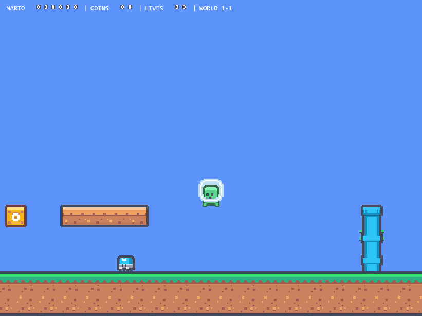

# Super Mario Bros — Workshop con agentes

Versión simplificada de **Super Mario Bros (1985)** construida con **Phaser 4** y **Vite**, como proyecto del workshop de programación con agentes de la UNRAF (DT2).

Mario recorre World 1-1: camina, salta, golpea bloques, recoge monedas y power-ups, esquiva o pisa enemigos y llega a la bandera antes de quedarse sin vidas.



## Requisitos

- [Node.js](https://nodejs.org) y npm (el proyecto también declara `pnpm` como package manager en `package.json`).

```bash
npm install
```

## Comandos

| Comando | Uso |
|---|---|
| `npm run dev` | Servidor de desarrollo en `http://localhost:8080` |
| `npm run dev-nolog` | Igual que `dev`, sin telemetría de la plantilla |
| `npm run build` | Build de producción en `dist/` |
| `npm run build-nolog` | Build de producción sin telemetría de la plantilla |
| `node --test tests/*.test.mjs` | Pruebas puras de layout y geometría del nivel |
| `node scripts/verify-level-design.cjs` | Verificación en Chrome headless (requiere Chrome instalado) |

El playtest manual en el navegador sigue siendo la verificación principal del gameplay.

## Controles

| Acción | Teclas |
|---|---|
| Caminar | `←` `→` o `A` `D` |
| Saltar | `Espacio`, `↑` o `W` |

En desarrollo se puede arrancar el nivel en otra posición con `?startX=<valor>` en la URL.

## Estructura del proyecto

| Ruta | Contenido |
|---|---|
| `index.html` | Contenedor `#game-container` donde se monta el juego |
| `src/main.js` | Bootstrap de la aplicación al cargar el DOM |
| `src/game/main.js` | Configuración de Phaser (1024 × 768, `Scale.FIT`, `Scale.CENTER_BOTH`) |
| `src/game/scenes/` | Escenas: `Boot`, `MainMenu`, `WorldScreen`, `Game`, `Hud`, `LevelComplete`, `GameOver`, `ResultScreen` |
| `src/game/entities/` | Entidades: `Mario`, `Goomba`, `PiranhaPlant`, `Coin`, `Mushroom`, `GoalPole` y bloques |
| `src/game/level/` | Datos del nivel (`world11.js`), ensamblado (`Environment.js`), layout de tiles (`tileLayout.js`) y validador (`validateLevel.js`) |
| `src/game/constants/` | Tuning centralizado: movimiento, daño, bloques, monedas, enemigos, assets |
| `src/game/state/` | Estado de partida (`GameState.js`) |
| `tests/` | Pruebas de contrato del layout y de geometría del nivel |
| `scripts/` | Verificación dirigida del nivel con Chrome/CDP |
| `assets/` | Spritesheets fuente (Kenney Pixel Platformer, CC0) |
| `public/` | Assets estáticos servidos en runtime y estilos |
| `docs/GDD.md` | Game Design Document: fuente de verdad del gameplay |
| `docs/screenshots/` | Capturas usadas en este README |
| `.sdd/` | Specs, planes y evidencia del proceso |
| `.opencode/skills/` | Skills locales de OpenCode |

## Proceso de desarrollo (SDD)

Todo cambio de comportamiento sigue el ciclo **spec → aprobación humana → plan → implementación → verificación → evidencia**, documentado en `.sdd/`:

- `docs/docs/GDD.md` manda en gameplay; `AGENTS.md` manda en ingeniería.
- Cada cambio revisable usa un identificador `NNN-slug` en `.sdd/specs/`, `.sdd/plans/` y `.sdd/evidence/`.
- La verificación disponible es `node --test tests/*.test.mjs`, `npm run build` y playtest manual; los resultados se registran sin inventar evidencia.

Skills locales del proyecto: `sdd-spec`, `sdd-plan`, `gdd-to-sdd`, `verify`, `repo-discovery` y `platformer-level-design`.

## Skill `platformer-level-design`: cómo funciona

El skill vive en `.opencode/skills/platformer-level-design/SKILL.md` y su checklist de cierre en `references/checklist.md`. No es código del juego: es una guía operativa que el agente carga cuando la tarea es **diseñar, ensamblar o auditar un nivel de plataformas**, o cuando hay que investigar atascos y saltos imposibles.

### Cuándo se activa

Su `description` en el frontmatter funciona como disparador: el agente lo carga al crear o modificar un nivel, al revisar rutas y saltos, o al diagnosticar por qué un tramo no se puede pasar. También puede invocarse explícitamente.

### Qué lee antes de proponer nada

1. `AGENTS.md`, el GDD, las specs aprobadas, el layout, el constructor del entorno, las hitboxes y las constantes de movimiento.
2. El atlas real de tiles, usando el skill `tileset-analyzer` para confirmar la topología de cada pieza. Nunca deduce el rol de un tile por su índice.
3. Las reglas de SDD: no crea specs, no cambia física, assets ni reglas sin aprobación.

### Vocabulario que obliga a definir

El skill exige que estos conceptos queden explícitos antes de tocar el nivel, porque son la causa habitual de niveles rotos:

- **Ruta principal**: conecta spawn con meta sin exigir power-ups, daño ni exploits. **Ruta opcional**: desvío con entrada, recompensa y salida comprobables.
- **Módulo visual**: familia de tiles y roles (aislado, izquierda, centro, derecha, superficie, relleno, base). No equivale al cuerpo físico.
- **Superficie**: sólida por todos lados, unidireccional o decorativa. No se cambia una por otra para tapar un atasco.
- **Envolvente de salto**: alturas y distancias medidas por forma, desde reposo y a carrera. La fórmula analítica es referencia, no evidencia.
- **Despegue** y **espacio de cabeza**: tramo donde el cuerpo abandona techos, considerando hitbox y trayectoria, no solo el sprite.
- **Aterrizaje**: apoyo con margen lateral y recuperación antes del siguiente peligro. Un píxel de apoyo no es una ruta confiable.
- **Legibilidad**: el arte, la profundidad y la colisión comunican dónde se puede caminar, saltar, esperar o recibir daño.

### Flujo de trabajo en 8 pasos

1. Inventariar capas y módulos; documentar unidades, origen de grilla, bordes y centros.
2. Clasificar familias y armar piezas de 1, 2, 4 y más columnas, rechazando los tamaños que la familia no admite.
3. Medir el salto libre y bajo techos; registrar tuning, forma, FPS, velocidad inicial y método de input.
4. Dibujar las conexiones de la ruta: despegue → trayectoria libre → aterrizaje. Revisar tubos, techos, pozos y encierros al crecer o recibir daño.
5. Reservar márgenes y zonas de espera; enseñar cada mecánica antes de combinarla con enemigos o pozos.
6. Comprobar cada recompensa con una ruta realizable y segura, no con la distancia teórica máxima.
7. Ejecutar validador, tests y build, y después probar en el navegador por módulos y desde spawn hasta la meta con peligros activos.
8. Guardar evidencia reproducible, separando los resultados según su nivel de confianza.

### Criterios de este proyecto

Son valores medidos para este juego y deben revalidarse si cambian la física o las hitboxes:

- Grilla de 18 px; unidades de mundo independientes del zoom 3.
- Small: 16 × 22. Super: 20 × 26. Movimiento en `src/game/constants/movement.js`.
- Salto libre observado: 63,3 px. Altura de diseño obligatoria: ≤ 54 px. Bajo techos puede ser mucho menor.
- Espacio inferior ≥ 35 px; las plataformas actuales dejan 36 px.
- Separación entre la salida de un techo y un tubo ≥ 38 px.
- Los pozos de 36 px se verifican a carrera y con margen: no se promete ese alcance desde reposo.
- `validateLevelGeometry` (en `src/game/level/validateLevel.js`) es una **guardia local**, no un solucionador de rutas: controla grilla, altura de escalón, espacio de cabeza, pista de carrera y ancho de pozo.

### Prohibiciones y condiciones de freno

- No aumentar el salto, achicar hitboxes, volver plataformas atravesables ni quitar enemigos para lograr un pase sin autorización.
- No depender de esquinas, tunneling, frame exacto u orden de colisión.
- No presentar teletransportes, peligros desactivados, vidas restauradas o victoria forzada como recorrido completo.
- Si la ruta no se puede verificar o contradice el GDD, se registra el bloqueo y la decisión pendiente; el nivel no se marca como terminado.

### Entrega esperada

Familias usadas, mapa/tabla de rutas, riesgos con ubicación, márgenes y medidas, archivos modificados, comandos con resultados, evidencia antes/después y limitaciones. El skill distingue explícitamente cinco niveles de evidencia:

1. análisis estático,
2. prueba local dirigida,
3. recorrido sin peligros,
4. recorrido real continuo con enemigos,
5. revisión humana.

Solo se afirma el nivel realmente alcanzado.

### Ejemplo de uso

```text
Usá el skill platformer-level-design para auditar el tramo de la tubería
de World 1-1: ¿el despegue tiene espacio de cabeza y el aterrizaje margen
suficiente para Small y Super? Registrá evidencia y no cambies la física.
```

El agente leerá el contexto del proyecto, medirá o verificará los saltos, aplicará la checklist y devolverá hallazgos con su nivel de evidencia.

## Assets y licencias

Sprites del paquete **Pixel Platformer** de [Kenney](https://kenney.nl/assets/pixel-platformer), licencia **CC0**. El código del proyecto se distribuye bajo la licencia incluida en `LICENSE`.
